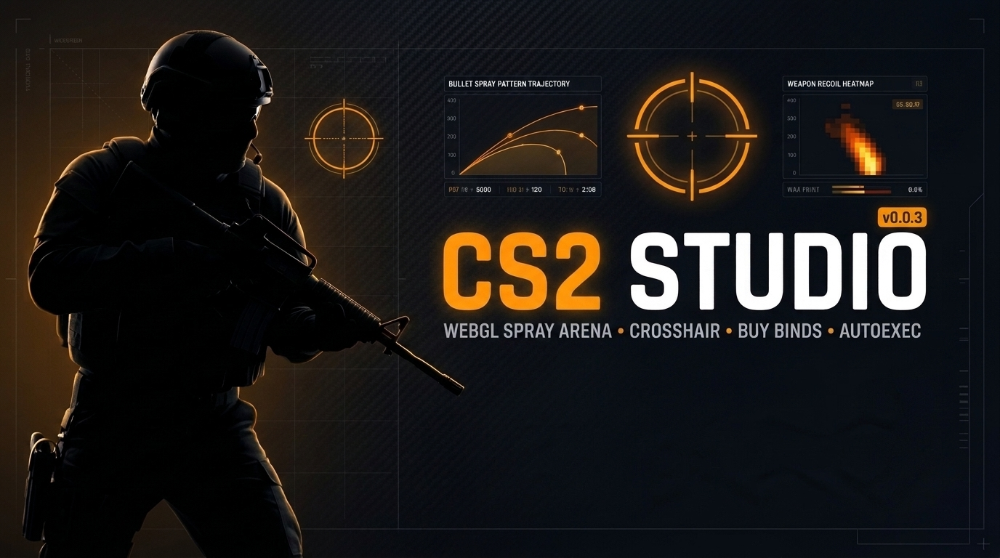

<div align="center">



# CS2 STUDIO `v0.0.3`

**The 100% Client-Side Counter-Strike 2 Configuration Suite — 3D Dust2 Spray Arena, CS2 Follow-Recoil Crosshair Generator, Live Viewmodel Simulator, Visual Buy Binds & Autoexec Exporter.**

[](https://cs2studio.haking.tr)
[](./LICENSE)
[](https://astro.build)
[](https://pages.cloudflare.com)
[](https://www.buymeacoffee.com/haking)

🌐 **Live Production**: [https://cs2studio.haking.tr](https://cs2studio.haking.tr) • 📧 **Support**: `cs2studio@haking.tr`

</div>

---

## Core Modules & v0.0.3 Upgrades

CS2 Studio runs entirely on static edge HTML + client-side browser storage (`localStorage`) with **zero database or login walls**:

| Route | Module | Key Capabilities |
| :--- | :--- | :--- |
| `/` | **Command Dashboard** | Live synced telemetry badges across LocalStorage modules |
| `/spray-arena` | **3D Dust2 Spray Arena** | Authentic `de_dust2_slice.glb` A-Long range, Source 2 HD `.glb` weapons, interactive recoil compensation vs pattern wall, raycasted bullet decals & `10m/20m/35m` distances |
| `/crosshair` | **CS2 Crosshair Generator** | `cl_crosshair_recoil` (Follow Recoil), CS2 Style 2 split spread parameters (`splitDistance`, `innerSplitAlpha`, `outerSplitAlpha`, `splitSizeRatio`), outline thickness, AWP scope width & exact `CS...` / `CSGO-...` Share Code codec |
| `/viewmodel` | **Live Viewmodel Simulator** | Real-time FOV and `offset_x` / `offset_y` / `offset_z` controls rendered in 3D on Dust2 Long A with Desktop / Couch / Classic presets |
| `/buy-binds` | **Visual Buy Binds Studio** | Full mechanical keyboard layout with SortableJS drag-and-drop & Pro Numpad / F-Key presets |
| `/autoexec` | **Autoexec.cfg Exporter** | Compiles crosshair, viewmodel, buy binds, sensitivity, FPS tweaks, telemetry, radar & competitive audio into downloadable `autoexec.cfg` |

---

## Localized SEO Static MPA Architecture

- **126 Static HTML Pages** generated ahead of time (`output: 'static'`): 6 default routes + 20 language prefixes (`/en/`, `/tr/`, `/ru/`, `/de/`, `/pt/`, `/es/`, `/pl/`, `/fr/`, `/zh/`, `/uk/`, `/sv/`, `/da/`, `/fi/`, `/nl/`, `/it/`, `/ja/`, `/ko/`, `/ar/`, `/cs/`, `/ro/`).
- Full `<link rel="canonical">`, `21` `<link rel="alternate" hreflang="...">` entries, **Open Graph / Twitter Card** banners (`1200x630`), **Schema.org `SoftwareApplication` JSON-LD**, `robots.txt`, and multi-lingual `sitemap.xml` on every build.

---

## Local Development

### Prerequisites
- **Node.js 20+** and **npm**

```bash
# Install dependencies
npm install

# Start Astro development server (http://localhost:4321)
npm run dev

# Build static MPA bundle (outputs cleanly to ./dist/)
npm run build

# Preview production dist/ locally
npm run preview
```

> **Note on Custom 3D Models**: All 10 Source 2 weapon `.glb` files and `de_dust2_slice.glb` live in `./public/models/`. You can also drag-and-drop any `.glb` directly onto the 3D viewport in `/spray-arena` or `/viewmodel` for instant local preview.

---

## Deploying to Cloudflare Pages

All static assets—including `./public/models/de_dust2_slice.glb` (`12.82 MB`)—stay well below Cloudflare Pages' 25 MiB single-file ceiling:

1. Push this repository to GitHub.
2. Open **Cloudflare Dashboard → Workers & Pages → Create Application → Pages → Connect to Git**.
3. Configure build settings:
   - **Framework preset**: `Astro`
   - **Build command**: `npm run build`
   - **Build output directory**: `dist`
4. Attach your custom domain (`cs2studio.haking.tr`) under **Custom domains**.

---

## Support & License

- **Maintainer**: **Halit Güneş** (`CS2 Studio`)
- **Contact / Bug Reports**: `cs2studio@haking.tr`
- **Support Development**: [buymeacoffee.com/haking](https://www.buymeacoffee.com/haking)
- **License**: Released under the [MIT License](./LICENSE). See [`public/models/THIRD_PARTY_NOTICES.md`](./public/models/THIRD_PARTY_NOTICES.md) for 3D mesh and recoil table attributions.
